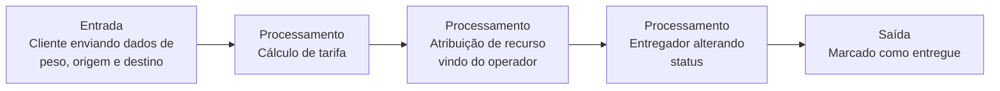
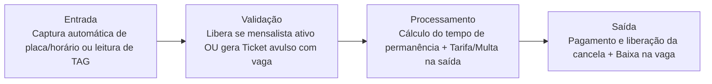

# EcoLogistics

---

## 📌 Contexto

A EcoLogistics é uma empresa de transporte sustentável que precisa automatizar sua operação de entregas urbanas usando bicicletas elétricas. Atualmente, os operadores de frota recebem solicitações de entrega por telefone e anotam em planilhas, o que causa atrasos e erros no cálculo de rotas. O diretor da empresa relatou que o principal gargalo é a perda de mercadorias por falta de acompanhamento do status do pacote em tempo real, gerando um prejuízo financeiro imenso. Para resolver isso, eles precisam de um sistema central onde o cliente corporativo realiza o pedido de envio indicando peso, endereço de origem e destino. O sistema deve calcular automaticamente a tarifa com base na distância e no peso. Apenas os operadores da frota têm permissão para aprovar o pedido e atribuir uma bicicleta disponível ao entregador. Se a bicicleta estiver com status de manutenção ou com carga de bateria abaixo de vinte por cento, a atribuição deve ser bloqueada imediatamente pelo sistema. O entregador, através da sua interface, só visualiza as entregas atribuídas a ele e deve atualizar o status para em trânsito e posteriormente para entregue. Caso o tempo estipulado para a entrega expire sem a confirmação do entregador, o sistema precisa sinalizar o pedido como crítico no painel do operador. O projeto precisa priorizar respostas rápidas na API e ter uma estrutura de dados consistente para suportar simulações de carga durante os testes de validação.

## 🎯 Problema de negócio

Que dor esse sistema resolve: o prejuízo financeiro de não saber o status da entrega.

> [!IMPORTANT]
> **Refinamento SPSkills:** a dor central é o prejuízo financeiro decorrente do extravio/perda de mercadorias e da falha no acompanhamento em tempo real. Tudo no sistema existe para dar rastreabilidade e controle de status.

## ❤️ Core Business

> [!IMPORTANT]
> **Gestão e rastreamento do ciclo de vida de um pedido/entrega.**

---

## 👥 Usuários

- Cliente
- Operadores de frota
- Entregador

## 📖 Histórias de usuário

- Cliente realiza pedido de envio (indicando peso, origem, endereço do destino e de onde irá vir)
- Operador de frota aprova pedido
- Operador de frota nega pedido
- Operador atribui bicicleta a entregador
- Entregador visualiza entregas atribuídas a ele
- Entregador pode alterar status entre em trânsito e entregue

## 📋 Regras de negócio

- Sistema deve calcular tarifa julgando distância e peso do item
- Operador de frota aprova ou nega pedido
- Bicicletas com status de manutenção ou com carga de bateria abaixo de vinte por cento não são liberadas para uso
- Entregador apenas visualiza entregas atribuídas a ele
- Entregador deve conseguir alterar status do pedido
- O sistema deve marcar como Prioridade as entregas que ultrapassam o tempo limite

---

## 🔑 Palavras-chave

- O sistema `deve` calcular automaticamente
- A atribuição `deve` ser bloqueada imediatamente pelo sistema
- `Deve` atualizar o status para em trânsito e posteriormente para entregue
- `Caso` o tempo estipulado para a entrega

## 📜 Regras de ouro

Padrão: **[QUEM] + [`PODE` / `NÃO PODE` / `SOMENTE SE`] + [AÇÃO]**

| Quem | Regra | Ação |
|---|---|---|
| **Cliente** | `PODE` | Criar pedido informando peso, origem e destino. |
| **Sistema** | `DEVE` | Calcular a tarifa automaticamente com base no peso e na distância. |
| **Operador** | `SOMENTE SE` tiver permissão | Pode aprovar pedidos e atribuir bicicletas/entregadores. |
| **Sistema** | `NÃO PODE` / `DEVE BLOQUEAR` | Atribuir uma bicicleta `SOMENTE SE` ela estiver em manutenção ou com bateria abaixo de 20%. |
| **Entregador** | `SOMENTE PODE` | Visualizar as entregas atribuídas a ele próprio. |
| **Entregador** | `DEVE` | Atualizar o status para "Em Trânsito" e depois "Entregue". |
| **Sistema** | `DEVE` | Alterar o status do pedido para Crítico/Alerta no painel do operador `SOMENTE SE` o tempo estipulado expirar sem a confirmação de entrega. |

---

## 🔄 Fluxo de valor

## 🧩 Suposição de funcionamento

- Entidade usuário, que pode ser cliente, operador de frota ou entregador
- Duas enums: uma atribuída à frota e outra atribuída ao entregador

> [!IMPORTANT]
> **Deve existir entidade pedido? SIMMMMMMM.** Não está explícito, porém é a base de tudo. É de extrema importância ter essa percepção durante a criação.

## ✅ Critério de sucesso

- Sistema do lado do pedido funcionando
- Sistema de status da entrega funcionando
- Sistema do operador funcionando

# SmartPark 

---

## 📌 Contexto

A empresa SmartPark precisa automatizar o controle de vagas e o faturamento de um estacionamento rotativo de grande porte. Atualmente, a entrada e saída são registradas em papel por cancelas manuais, gerando filas e fraudes no controle de tempo. O sistema central deve registrar a entrada do veículo capturando a placa e o horário de forma automática. Existem três perfis de usuários: Operador, Cliente Mensalista e Administrador. O Operador apenas visualiza e libera vagas comuns. O Cliente Mensalista tem acesso liberado por tag, mas o sistema deve bloquear a entrada somente se a mensalidade estiver vencida. O cálculo da tarifa para os avulsos deve ser feito automaticamente pelo sistema com base no tempo de permanência, aplicando multas se o ticket for perdido. O Administrador tem permissão para emitir relatórios financeiros e alterar valores de tarifas. O projeto precisa priorizar consultas rápidas na tabela de placas para evitar gargalos na cancela.

## 🎯 Problema de negócio

Que dor esse sistema resolve: Mapeamento de um estacionamento e controle de faturamento.

Ajuste Prova: A dor real descrita no texto é o atraso/filas na entrada/saída devido às cancelas manuais em papel e o prejuízo/fraude financeira no controle de tempo e perda de tickets. O sistema vem para dar automação, velocidade na cancela e controle de faturamento imutável.

---

## 👥 Usuários

- Operador
- Cliente Mensalista
- Administrador

## 📖 Histórias de usuário

- Administrador pode emitir relátorios.
- Administrador consegue editar campo que dá valor a tarifa.
- Como cliente quero receber ticket da minha vaga.
- Como cliente quero assinar plano mensal.
- Como cliente pagar valor da tarifa.

## 📋 Regras de negócio

- Operador apenas vizualiza vagas comuns.
- Mensalista tem acesso liberado por TAG.
- Sistema bloqueia mensalista se mensalidade estiver vencida (prazo expirado).
- Sistema deve calcular tarifa com base no tempo de permanencia para avulsos.
- Multa caso perda de ticket.
- Administrador pode emitir relátorios.
- Administrador consegue editar campo que dá valor a tarifa.

---

## 🔑 Palavras-chave

- O sistema central `deve` registrar a entrada do veículo capturando a placa e o horário de forma automática.
- Sistema `deve` bloquear a entrada.
- Tarifa para os avulsos `deve` ser feito automaticamente.
- Bloquear a entrada `somente` se a mensalidade estiver vencida.

## 3. As Regras de Ouro (Tabela Ajustada para o SmartPark)

Padrão: **[QUEM] + [PODE / NÃO PODE / DEVE / SOMENTE SE] + [AÇÃO]**

| **Quem** | **Regra** | **Ação** |
| --- | --- | --- |
| **Sistema** | `DEVE` | Registrar automaticamente a entrada do veículo capturando a placa e o horário. |
| **Operador** | `SOMENTE PODE` | Visualizar e liberar vagas comuns para veículos. |
| **Cliente Mensalista** | `PODE` | Acessar o estacionamento de forma liberada utilizando sua TAG. |
| **Sistema** | `DEVE BLOQUEAR` | A entrada do Cliente Mensalista `SOMENTE SE` a mensalidade estiver vencida. |
| **Sistema** | `DEVE` | Calcular automaticamente a tarifa dos clientes avulsos com base no tempo de permanência. |
| **Sistema** | `DEVE` | Aplicar cobrança de multa ao cliente avulso `SOMENTE SE` o ticket for perdido. |
| **Administrador** | `PODE` | Emitir relatórios financeiros e alterar os valores das tarifas no sistema. |

---

## 🔄 Fluxo de valor

## 🧩 Suposição de funcionamento

- Sistema de alguma forma como scanner capta placa e hora que chega e guarda informação na entidade ticket.
- Na regra de usuário, o sistema valida se o cliente é do tipo mensalista e se sua chave está ativa para liberar sem cobrar.
- Se usuário vem do nada, precisa pegar placa e hora de chegada para começar a ser cobrado.
- Administrador puxa histórico de tudo.
- Adminstrador pode alterar o valor fixo do ticket na hora de cobrar.
- Operador consegue ver vagas livres e as escolhe para atribuir ao cliente.

> [!IMPORTANT]
> **Deve existir entidade vagas/ vagas livres? SIMMMMMMM.**

⚠️ **Ponto de Atenção na sua nota [IMPORTANT] sobre as Vagas:**

Você comentou: "Cada ticket tem seu id com vaga utilizada, logo ele não precisaria de uma entidade vaga..."

Atenção: Na WorldSkills/SPSKILLS, a entidade Vaga DEVE EXISTIR SIM como uma tabela separada no banco de dados!

Por quê? Se você não tiver uma tabela Vagas (com status LIVRE, OCUPADA, MANUTENÇÃO), como o Operador vai visualizar na tela o mapa de vagas disponíveis antes de emitir o ticket? Como o sistema vai saber o limite total de vagas do estacionamento se todas as vagas só existirem dentro de tickets?

**Modelagem Correta:**

- Tabela Vaga (id, numero, status)
- Tabela Ticket (id, placa, data_hora_entrada, data_hora_saida, valor_pago, vaga_id, usuario_id)

## ✅ Critério de sucesso

- Ticket funciona com as informações necessarias.
- Administrador consegue editar ticket (campo preço).
- Operador faz chegar vaga livre em alguém.
