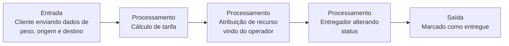

# EcoLogistics

---

## 📌 Contexto

A EcoLogistics é uma empresa de transporte sustentável que precisa automatizar sua operação de entregas urbanas usando bicicletas elétricas. Atualmente, os operadores de frota recebem solicitações de entrega por telefone e anotam em planilhas, o que causa atrasos e erros no cálculo de rotas. O diretor da empresa relatou que o principal gargalo é a perda de mercadorias por falta de acompanhamento do status do pacote em tempo real, gerando um prejuízo financeiro imenso. Para resolver isso, eles precisam de um sistema central onde o cliente corporativo realiza o pedido de envio indicando peso, endereço de origem e destino. O sistema deve calcular automaticamente a tarifa com base na distância e no peso. Apenas os operadores da frota têm permissão para aprovar o pedido e atribuir uma bicicleta disponível ao entregador. Se a bicicleta estiver com status de manutenção ou com carga de bateria abaixo de vinte por cento, a atribuição deve ser bloqueada imediatamente pelo sistema. O entregador, através da sua interface, só visualiza as entregas atribuídas a ele e deve atualizar o status para em trânsito e posteriormente para entregue. Caso o tempo estipulado para a entrega expire sem a confirmação do entregador, o sistema precisa sinalizar o pedido como crítico no painel do operador. O projeto precisa priorizar respostas rápidas na API e ter uma estrutura de dados consistente para suportar simulações de carga durante os testes de validação.

## 🎯 Problema de negócio

Que dor esse sistema resolve: o prejuízo financeiro de não saber o status da entrega.

> [!IMPORTANT]
> **Refinamento SPSkills:** a dor central é o prejuízo financeiro decorrente do extravio/perda de mercadorias e da falha no acompanhamento em tempo real. Tudo no sistema existe para dar rastreabilidade e controle de status.

## ❤️ Core Business

> [!IMPORTANT]
> **Gestão e rastreamento do ciclo de vida de um pedido/entrega.**

---

## 👥 Usuários

- Cliente
- Operadores de frota
- Entregador

## 📖 Histórias de usuário

- Cliente realiza pedido de envio (indicando peso, origem, endereço do destino e de onde irá vir)
- Operador de frota aprova pedido
- Operador de frota nega pedido
- Operador atribui bicicleta a entregador
- Entregador visualiza entregas atribuídas a ele
- Entregador pode alterar status entre em trânsito e entregue

## 📋 Regras de negócio

- Sistema deve calcular tarifa julgando distância e peso do item
- Operador de frota aprova ou nega pedido
- Bicicletas com status de manutenção ou com carga de bateria abaixo de vinte por cento não são liberadas para uso
- Entregador apenas visualiza entregas atribuídas a ele
- Entregador deve conseguir alterar status do pedido
- O sistema deve marcar como Prioridade as entregas que ultrapassam o tempo limite

---

## 🔑 Palavras-chave

- O sistema `deve` calcular automaticamente
- A atribuição `deve` ser bloqueada imediatamente pelo sistema
- `Deve` atualizar o status para em trânsito e posteriormente para entregue
- `Caso` o tempo estipulado para a entrega

## 📜 Regras de ouro

Padrão: **[QUEM] + [`PODE` / `NÃO PODE` / `SOMENTE SE`] + [AÇÃO]**

| Quem | Regra | Ação |
|---|---|---|
| **Cliente** | `PODE` | Criar pedido informando peso, origem e destino. |
| **Sistema** | `DEVE` | Calcular a tarifa automaticamente com base no peso e na distância. |
| **Operador** | `SOMENTE SE` tiver permissão | Pode aprovar pedidos e atribuir bicicletas/entregadores. |
| **Sistema** | `NÃO PODE` / `DEVE BLOQUEAR` | Atribuir uma bicicleta `SOMENTE SE` ela estiver em manutenção ou com bateria abaixo de 20%. |
| **Entregador** | `SOMENTE PODE` | Visualizar as entregas atribuídas a ele próprio. |
| **Entregador** | `DEVE` | Atualizar o status para "Em Trânsito" e depois "Entregue". |
| **Sistema** | `DEVE` | Alterar o status do pedido para Crítico/Alerta no painel do operador `SOMENTE SE` o tempo estipulado expirar sem a confirmação de entrega. |

---

## 🔄 Fluxo de valor

## 🧩 Suposição de funcionamento

- Entidade usuário, que pode ser cliente, operador de frota ou entregador
- Duas enums: uma atribuída à frota e outra atribuída ao entregador

> [!IMPORTANT]
> **Deve existir entidade pedido? SIMMMMMMM.** Não está explícito, porém é a base de tudo. É de extrema importância ter essa percepção durante a criação.

## ✅ Critério de sucesso

- Sistema do lado do pedido funcionando
- Sistema de status da entrega funcionando
- Sistema do operador funcionando