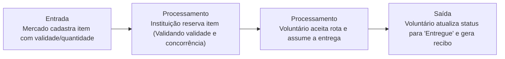

# NutriRede

---

## 📌 Contexto

A ONG NutriRede quer conectar mercados locais que possuem excedentes de alimentos próximos ao vencimento com instituições de caridade cadastradas. O problema atual é a desorganização por WhatsApp, onde os alimentos estragam antes de serem alocados. O sistema deve permitir que o Mercado cadastre os itens informando nome, quantidade, categoria e data de validade. As Instituições de caridade visualizam os itens disponíveis na sua região e podem solicitar a reserva. Apenas os Voluntários de logística aprovados têm permissão para aceitar a rota de entrega. O sistema não pode permitir a reserva de um item cujo prazo de validade já tenha expirado. O fluxo termina quando o voluntário atualiza o status para "Entregue na Instituição", gerando um recibo digital automático. O sistema deve garantir integridade transacional para que o mesmo item não seja reservado por duas instituições simultaneamente.

## ❤️ Core Business

Impedir que os alimentos perto da data de vencimento deixem de ser doados a instituições de caridade.

> [!IMPORTANT]
> **Refinamento SPSkills:** o coração do sistema é o Ciclo de Vida da Doação com Reserva Concorrente e Logística (Cadastro pelo Mercado -> Reserva pela Instituição -> Atribuição e Entrega pelo Voluntário). Sem essa esteira integrada, o alimento estraga por desorganização.

---

## 👥 Usuários

- Mercado
- Instituição de Caridade
- Voluntários

## 📖 Histórias de usuário

- Como mercado, quero adicionar lista de doação com campos como nome, quantidade, categoria e prazo de validade
- Como órgão receptor, quero visualizar mercados da minha região doando alimentos

## 📋 Regras de negócio

- Mercado adiciona item à doação
- Doação precisa ser visível ao órgão receptor
- Mercado solicita reserva de doação específica
- Somente voluntários aprovados podem aceitar a rota para enviar a entrega
- O sistema não pode permitir a reserva de um item cujo prazo de validade já tenha vencido
- O fluxo encerra quando o voluntário atualiza o status para entregue à instituição

---

## 🔑 Palavras-chave

- O sistema `deve` garantir integridade transacional
- O sistema `não pode` permitir a reserva de um item cujo prazo de validade

## 📜 Regras de ouro

Padrão: **[QUEM] + [`PODE` / `NÃO PODE` / `DEVE` / `SOMENTE SE`] + [AÇÃO]**

| Quem | Regra | Ação |
|---|---|---|
| **Mercado** | `PODE` | Cadastrar itens de doação informando nome, quantidade, categoria e data de validade. |
| **Instituição de Caridade** | `PODE` | Visualizar itens disponíveis na sua região e solicitar a reserva. |
| **Sistema** | `NÃO PODE` | Permitir a reserva de um item cujo prazo de validade já tenha expirado. |
| **Voluntário de Logística** | `SOMENTE SE` aprovado | Ter permissão para aceitar a rota de entrega da doação. |
| **Sistema** | `DEVE` | Garantir integridade transacional para que o mesmo item não seja reservado por duas instituições simultaneamente. |
| **Voluntário** | `DEVE` | Atualizar o status para "Entregue na Instituição" para encerrar o ciclo, gerando recibo digital. |

---

## 🔄 Fluxo de valor

## 🧩 Suposição de funcionamento

Existe implicitamente a entidade doação. Ela será criada pelo mercado e visualizada pelas instituições, que também a solicitam para ficar com a reserva. Depois, um usuário voluntário precisa aprovar e acompanhar o envio.

Entidades principais identificadas:

- **Usuário** (com perfis: Mercado, Instituição, Voluntário, Administrador)
- **Doação** ou **ItemDoação** (guarda nome, categoria, quantidade, validade, status e ID do mercado criador)
- **Reserva** ou **Transação** (controla qual instituição reservou qual item e garante a integridade transacional contra reservas duplicadas)
- **RotaEntrega** (vincula o voluntário à doação aceita)