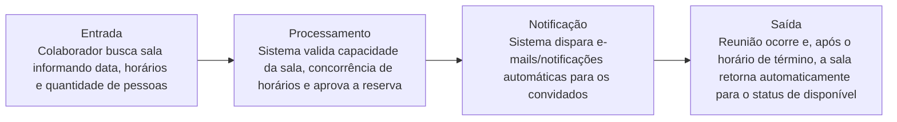

# OfficeSpace

---

## 📌 Contexto

Um prédio comercial precisa organizar a utilização de suas salas de reunião compartilhadas para evitar conflitos de horários entre equipes. O sistema deve permitir que qualquer Colaborador busque salas disponíveis indicando data, horário de início, término e quantidade de pessoas. O sistema só pode permitir a reserva se a capacidade da sala for igual ou superior ao número de pessoas informado e o horário estiver livre. O sistema deve enviar uma notificação automática para os convidados. Apenas o organizador da reunião ou o Administrador do sistema pode cancelar a reserva. O fluxo de valor garante que, após o horário de término, a sala volte automaticamente para o status de disponível para novas reservas.

## ❤️ Core Business

A base de tudo seria uma entidade do evento, para verificar o ciclo do status do evento e resolver o problema de conflito de agenda que um espaço pode acabar tendo.

> [!IMPORTANT]
> O coração do sistema é o **Motor de Agendamento Concorrente com Validação de Capacidade e Conflito de Horários.** Sem a trava que impede reservas cruzadas e valida se a lotação da sala suporta o público, o sistema falha no seu objetivo principal.

Foco: bloqueio ocorrido devido ao status.

---

## 👥 Usuários

- Colaborador/Organizador
- Administrador

## 📖 Histórias de usuário

- Como colaborador, quero encontrar salas disponíveis indicando data, horário de início, término e horários livres
- Após o término de uma reunião, a sala deve voltar a ter status disponível
- Como administrador, quero poder cancelar um evento
- Como organizador, quero poder cancelar um evento
- Como colaborador, quero agendar um evento

## 📋 Regras de negócio

- Não especifica quem pode cadastrar evento; supus que seria o colaborador o responsável
- O sistema deve só permitir a reserva se a capacidade da sala for igual (=) ou superior (>) ao número de pessoas informado
- O sistema também deve bloquear se o horário não estiver livre
- O sistema deve enviar uma notificação automática para os convidados
- Somente Administrador e organizador podem cancelar reserva

---

## 🔑 Palavras-chave

- O sistema `deve` permitir que qualquer Colaborador busque salas disponíveis indicando data
- O sistema `deve` enviar uma notificação automática para os convidados

## 📜 Regras de ouro

Padrão: **[QUEM] + [`PODE` / `NÃO PODE` / `DEVE` / `SOMENTE SE`] + [AÇÃO]**

| Quem | Regra | Ação |
|---|---|---|
| **Colaborador** | `PODE` | Buscar salas disponíveis informando data, horários de início e término, e quantidade de pessoas. |
| **Sistema** | `SOMENTE SE` | A capacidade da sala for igual ou superior (>=) ao número de pessoas E o horário estiver livre `PODE` confirmar a reserva. |
| **Sistema** | `DEVE` | Enviar uma notificação automática para os convidados após a confirmação da reserva. |
| **Organizador / Administrador** | `SOMENTE PERMITIDO` | Cancelar a reserva da sala de reunião. |
| **Sistema** | `DEVE` | Atualizar automaticamente o status da sala para "disponível" após o horário de término da reunião. |

---

## 🔄 Fluxo de valor

## 🧩 Suposição de funcionamento

Precisa haver um usuário colaborador/organizador. Ele irá visualizar onde pode realizar o evento dele, e o sistema funcionará por trás para informar se está impossibilitado ou não de ser usado (programando a lógica e permissões). Isso é relacionado a uma sala: existe a entidade sala com o campo status definindo como está a situação atual, e isso define o bloqueio. Depois disso, não há menção de edição, apenas que, para excluir, somente ele mesmo ou um administrador da página conseguiria.

- **A regra de exclusão/cancelamento:** [ORGANIZADOR / ADMINISTRADOR] + [`PODE`] + [Excluir ou Cancelar o evento criado]. Nenhum outro usuário comum tem permissão para apagar a reserva de outra pessoa.
- **A entidade Sala e o status:** a tabela Sala possui o campo status (DISPONIVEL, OCUPADA, MANUTENCAO), que é atualizado automaticamente pelo sistema de acordo com o horário do evento (ou manualmente pelo Admin).
- **A lógica de impedimento:** o sistema faz a validação cruzada por trás dos panos (Backend Validation): verifica se o intervalo de tempo desejado bate com outro evento ativo na mesma sala E se a capacidade atende ao número de pessoas. Se violar qualquer uma das duas condições, a API bloqueia o agendamento e retorna um erro amigável.