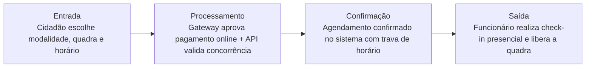

# SportBooking

---

## 📌 Contexto

Um complexo esportivo municipal precisa de automação para a locação de suas quadras de futebol, tênis e basquete. Hoje, o agendamento é feito por caderneta, resultando em horários duplos e brigas. O sistema deve permitir que o Cidadão crie uma conta, selecione a modalidade, a quadra e o horário disponível. O pagamento da taxa de reserva deve ser processado online, e o sistema só pode confirmar o agendamento após a aprovação do gateway de pagamento. Os Funcionários do complexo gerenciam o painel de check-in, onde validam a presença do cidadão e liberam o acesso à quadra. O sistema deve bloquear automaticamente novas reservas de um usuário que acumule duas faltas sem cancelamento prévio. O projeto exige alta disponibilidade e validação estrita de concorrência de horários na API.

## ❤️ Core Business

> [!IMPORTANT]
> O coração do sistema é o **Gerenciamento de Agendamento Concorrente com Validação de Pagamento e Check-in.** Sem a garantia de que o mesmo horário não será vendido para duas pessoas e de que o pagamento foi processado, o sistema perde o seu propósito principal.

---

## 👥 Usuários

- Cidadão
- Funcionários

(Podemos considerar implicitamente o Administrador/Gateway de Pagamento para os eventos de callback de pagamento.)

## 📖 Histórias de usuário

- Como cidadão, quero poder criar conta
- Como cidadão, quero selecionar a modalidade
- Como cidadão, quero escolher a quadra disponível
- Como cidadão, quero escolher horário disponível
- Como cidadão, quero pagar online
- Como funcionário, quero validar a presença do cidadão

## 📋 Regras de negócio

- Sistema libera agendamento após pago
- Funcionário consegue ver no sistema cliente presente
- Bloquear novas reservas de um usuário que acumule duas faltas sem cancelamento prévio

---

## 🔑 Palavras-chave

- O sistema `deve` permitir que o Cidadão crie uma conta
- Pagamento da taxa de reserva `deve` ser processado online
- Sistema `deve` bloquear automaticamente novas reservas

## 📜 Regras de ouro

Padrão: **[QUEM] + [`PODE` / `NÃO PODE` / `DEVE` / `SOMENTE SE`] + [AÇÃO]**

| Quem | Regra | Ação |
|---|---|---|
| **Cidadão** | `PODE` | Criar conta, selecionar modalidade, quadra e horário disponível. |
| **Sistema** | `SOMENTE SE` | O gateway de pagamento aprovar o pagamento online `PODE` confirmar o agendamento. |
| **Funcionário** | `PODE` | Acessar o painel de check-in, validar a presença do cidadão e liberar o acesso à quadra. |
| **Sistema** | `DEVE BLOQUEAR` | Novas reservas de um usuário `SOMENTE SE` ele acumular duas faltas sem cancelamento prévio. |
| **Sistema / API** | `DEVE` | Garantir validação estrita de concorrência para impedir agendamentos duplos no mesmo horário/quadra. |

---

## 🔄 Fluxo de valor

## 🧩 Suposição de funcionamento

- Existe a entidade de estabelecimentos, que pode ser temporariamente atribuída a um usuário
- Ocorrendo apenas se o usuário pagar para usufruir
- Funcionário valida se há alguém ali

Entidades principais identificadas:

- **Usuário** (dados do cidadão/funcionário, além de um campo para controle de faltas_acumuladas, para aplicação da regra do bloqueio)
- **Quadra** (vinculada à modalidade: Futebol, Tênis, Basquete, e ao status de disponibilidade)
- **Reserva** (tabela relacional principal que conecta Usuário, Quadra, data/horário, status e o ID da transação do gateway)

> [!NOTE]
> Status da Reserva: PENDENTE_PAGAMENTO, CONFIRMADA, CANCELADA, FINALIZADA_COM_CHECKIN, FALTA.