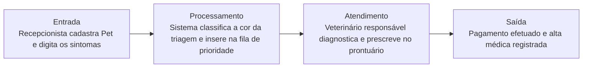

# VetCare

---

## 📌 Contexto

Uma clínica veterinária 24 horas precisa automatizar a triagem e o atendimento de animais de estimação para reduzir o tempo de espera em casos graves. O Tutores chegam à clínica e realizam um pré-cadastro na recepção informando os sintomas do pet. O Recepcionista cadastra o animal e o sistema deve classificar automaticamente a cor da triagem (Verde, Amarelo, Vermelho) com base em palavras-chave de gravidade descritas nos sintomas. O Veterinário visualiza a fila ordenada por prioridade de risco. Apenas o veterinário responsável pode atualizar o prontuário com o diagnóstico e prescrever medicamentos. O fluxo é encerrado quando o pagamento é processado e a alta médica é emitida. A consistência dos dados de histórico médico do animal é o ponto mais crítico da arquitetura.

## ❤️ Core Business

> [!IMPORTANT]
> Reduzir o tempo de espera de casos graves relacionados à saúde do animal, para poder dar prioridade aos animais que estão correndo maior perigo, sendo o relatório do animal o principal de tudo, pois ele tem as informações mais necessárias e interliga tudo.

Foco em palavras-chave (a regra de status é a mais principal).

Palavra-chave do core business: **ciclo do processo**.

---

## 👥 Usuários

- Tutores
- Recepcionista
- Pet (entidade cadastrada por recepcionista)
- Veterinário

## 📖 Histórias de usuário

- Como tutor, quero ser cadastrado na plataforma
- Como recepcionista, quero cadastrar pets na plataforma
- Como veterinário, quero poder visualizar animais com sua condição por ordem de urgência
- Como veterinário, quero conseguir alterar as informações do prontuário com o diagnóstico e prescrever medicamentos

## 📋 Regras de negócio

- Sistema cadastra animal e atribui uma triagem
- Campo status define a prioridade com a qual deve ser exibido
- Somente veterinário altera informações adicionadas de um pet
- Somente recepcionista cadastra pessoa/animal

---

## 🔑 Palavras-chave

- Sistema `deve` classificar automaticamente a cor da triagem

## 📜 Regras de ouro

Padrão: **[QUEM] + [`PODE` / `NÃO PODE` / `DEVE` / `SOMENTE SE`] + [AÇÃO]**

| Quem | Regra | Ação |
|---|---|---|
| **Recepcionista** | `PODE` | Cadastrar o Tutor, o Pet e registrar os sintomas informados. |
| **Sistema** | `DEVE` | Classificar automaticamente a cor da triagem (Verde, Amarelo, Vermelho) com base nas palavras-chave de gravidade dos sintomas. |
| **Veterinário** | `PODE` | Visualizar a fila de atendimento ordenada prioritariamente por nível de risco. |
| **Veterinário** | `SOMENTE SE` for o responsável | `PODE` atualizar o prontuário com o diagnóstico e prescrever medicamentos. |
| **Sistema** | `NÃO PODE` | Permitir que perfis que não sejam o Veterinário Responsável alterem o prontuário médico. |
| **Sistema / Caixa** | `DEVE` | Encerrar o atendimento `SOMENTE SE` o pagamento for processado e a alta médica emitida. |

---

## 🔄 Fluxo de valor

## 🧩 Suposição de funcionamento

Tutor cadastrado pelo usuário ADM do recepcionista, que cadastra o animal com sua condição. Tutor tem animal relacionado a ele, os dados são enviados ao médico e há a regra de negócio que determina como devem aparecer os dados, com o campo "status" como "vermelho = máxima, amarelo = média, verde = baixa". Médico altera as informações, preenche alta e, a partir disso, o pagamento é efetuado e libera o cliente.

Relações e entidades identificadas:

- Tutor 1:N Pet 1:N Atendimento/Prontuário
- **Prontuário:** tabela vinculada ao PetId e VeterinarioId. Deve ser imutável para manter a integridade legal do histórico médico do animal.
- **Enum NivelRisco:** VERDE, AMARELO, VERMELHO
- **Enum StatusAtendimento:** AGUARDANDO_TRIAGEM, EM_ATENDIMENTO, AGUARDANDO_PAGAMENTO, ALTA_EMITIDA